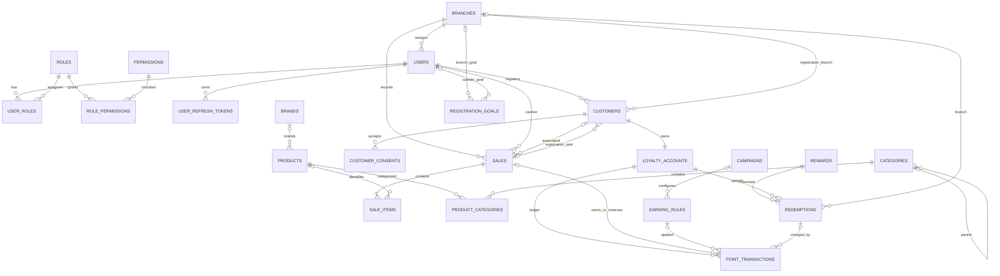

# Yepas Loyalty — Database Reference for AI Agents

> **Purpose:** This document is the functional and technical reference for understanding, extending, and implementing the Yepas Loyalty PostgreSQL database. It is written for developers and coding agents working on the Node.js/Express API, POS/NAV integration, employee authentication, customer registration, loyalty points, rewards, and registration goals.
>
> **Source of truth:** The Knex migrations are authoritative for the physical schema. If this document and a migration differ, inspect the migration and update this document rather than silently assuming the documented schema exists.

## 1. Project scope

Yepas Loyalty is a loyalty platform integrated with store POS systems / Microsoft Dynamics NAV or LS Retail. It stores customer profiles, sales received from POS, loyalty accounts, point movements, campaigns, earning rules, rewards, redemptions, employee identities, and customer-registration goals.

### Included

- Employee authentication and authorization (RBAC).
- Customer registration promoted by cashiers at checkout.
- Attribution of each customer registration to the employee and branch that acquired the customer.
- Registration goals at global, branch, or individual cashier level.
- Product, category, and brand catalog synchronized from NAV/POS.
- Sales and sale-line ingestion from POS/NAV.
- Loyalty accounts and an auditable point transaction ledger.
- Earning campaigns/rules and redeemable rewards.
- Idempotent integration event ingestion.
- Customer consent history.

### Explicitly excluded

- **Customer login/authentication.** Customers are loyalty members, not application users. They do not have passwords, refresh tokens, or login OTPs in this database.
- **Customer segmentation.** No segment tables or segment membership logic are part of the target schema.

Employee users and loyalty customers are separate concepts. Never use `customers` as an authentication table. Only employees stored in `users` authenticate to the internal application/API.

## 2. Technology and conventions

- Database: PostgreSQL 14 or newer.
- Migrations: Knex.js 3.x, CommonJS migration files.
- Runtime integration expected: Node.js / Express API.
- PostgreSQL extension: `pgcrypto`, used for `gen_random_uuid()`.
- Primary keys: UUID, generated by PostgreSQL unless explicitly supplied.
- Timestamps: timezone-aware (`TIMESTAMPTZ`). Store instants in UTC; calculate business periods using the `America/Mexico_City` timezone and convert boundaries to UTC.
- Money: `NUMERIC`, never floating point.
- Points: `BIGINT` integer values. `point_transactions.points` is a signed delta.
- Flexible provider/source data: `JSONB` (`metadata`, `conditions`, `payload`, `source_payload`). Validate JSON structures in the API.
- Standard timestamps: most tables use Knex `timestamps(true, true)`, producing `created_at` and `updated_at`.
- Naming: `snake_case` for tables and columns.
- Foreign keys should be respected; do not bypass referential integrity for convenience.

## 3. Migration files and execution order

Run migrations in this order:

1. `migrations/202611240001_initial_loyalty_schema.js`
   - Creates the original loyalty schema: branches, customers, catalog, sales, points, campaigns, rewards, redemptions, and integration events.
   - The initial migration also creates legacy customer segmentation and customer OTP tables temporarily.
2. `migrations/202611250001_employee_auth_registration_goals.js`
   - Adds employee authentication/RBAC.
   - Adds cashier attribution to customer registration and sales.
   - Adds registration goals.
   - Drops the legacy customer authentication and segmentation tables.
   - Seeds standard roles, permissions, and role-permission grants.

Install and migrate:

```bash
npm install knex pg
npx knex init
npx knex migrate:latest
```

Rollback the most recent migration:

```bash
npx knex migrate:rollback
```

Example `knexfile.js` (CommonJS):

```js
module.exports = {
  development: {
    client: 'pg',
    connection: process.env.DATABASE_URL || {
      host: process.env.DB_HOST || '127.0.0.1',
      port: Number(process.env.DB_PORT || 5432),
      user: process.env.DB_USER || 'postgres',
      password: process.env.DB_PASSWORD,
      database: process.env.DB_NAME || 'yepas_loyalty'
    },
    migrations: {
      directory: './migrations',
      tableName: 'knex_migrations'
    },
    pool: { min: 2, max: 10 }
  }
};
```

Do not edit an already-applied migration in a shared or deployed environment. Create a new migration for schema changes. The second migration's `down()` restores the legacy customer segment and OTP tables because it rolls back to the previous schema version; this does not mean those features belong in the current target scope.

## 4. Current physical schema — 23 tables

The target schema contains **23 tables** after both migrations have run.

### 4.1 Employee authentication and authorization (6 tables)

| Table | Purpose | Important fields / notes |
|---|---|---|
| `users` | Internal Yepas employees who can sign in | `employee_code` unique, `username` unique, optional unique `email`, `password_hash`, optional `branch_id`, `must_change_password`, `is_active`, login/password timestamps |
| `roles` | Application roles | Unique `code`, `name`, `description`, `is_system` |
| `permissions` | Fine-grained capabilities | Unique `code`, `name`, `description` |
| `user_roles` | Many-to-many user/role assignment | Composite PK: (`user_id`, `role_id`); optional `assigned_by_user_id`, `assigned_at` |
| `role_permissions` | Many-to-many role/permission assignment | Composite PK: (`role_id`, `permission_id`) |
| `user_refresh_tokens` | Employee refresh-session records | Stores unique `token_hash`, never a raw refresh token; includes expiry, revocation and last-use timestamps |

Seeded roles:

- `CASHIER` — cashier; promotes and registers customers at the point of sale.
- `SUPERVISOR` — supervises results and branches.
- `BRANCH_MANAGER` — manages branch operations.
- `LOYALTY_ADMIN` — administers the loyalty program.

Seeded permission codes:

- `customers.read`
- `customers.create`
- `customers.update`
- `sales.read`
- `loyalty.read`
- `rewards.manage`
- `goals.read`
- `goals.manage`
- `reports.read`
- `users.manage`
- `roles.manage`

The migration does **not** create an initial administrator account or default password. Provision the first administrator through a secure deployment/administrative process. Hash passwords with Argon2id or bcrypt. Use short-lived access tokens, refresh-token rotation, revocation, login rate limiting, and authorization checks on every protected endpoint.

### 4.2 Branches, customers, and consent (3 tables)

| Table | Purpose | Important fields / notes |
|---|---|---|
| `branches` | Yepas stores/branches | Unique `code`, `name`, `is_active` |
| `customers` | Loyalty customer profile | Unique `phone`; optional unique `email`; name, birth date, status, `registered_at`, `last_activity_at`; registration attribution fields described below |
| `customer_consents` | Consent history | `customer_id`, `consent_type`, `accepted`, `document_version`, `accepted_at`, `source`, `metadata` |

Customer registration attribution fields added by migration 2:

- `registered_by_user_id`: employee who acquired/registered the customer; FK to `users`.
- `registration_branch_id`: branch where the registration occurred; FK to `branches`.
- `registration_source`: source label, default `BACKOFFICE`; expected values include `POS`, `BACKOFFICE`, `IMPORT`, `WEB`.
- `registration_at`: effective registration timestamp.
- `registration_sale_id`: optional FK to the POS sale associated with the registration.

`registered_at` already exists in the initial migration and is separate from the later-added `registration_at`. The current physical schema therefore contains both. Do not assume one has been removed. Before changing this, decide which timestamp is canonical, migrate existing data safely, and update API/reporting consumers. A reasonable future convention is to standardize on `registration_at` and deprecate `registered_at` through a new migration, but that change has not yet been implemented.

`customer_consents` should keep separate records for terms, privacy notice, and marketing consent. Do not assume acceptance of one implies acceptance of another.

### 4.3 Product catalog (4 tables)

| Table | Purpose | Important fields / notes |
|---|---|---|
| `brands` | Product brands | Optional unique NAV `external_id`, unique `name`, `is_active` |
| `categories` | Hierarchical product categories | Optional unique NAV `external_id`, `name`, nullable self-reference `parent_id`, `is_active`; unique (`parent_id`, `name`) |
| `products` | Product master | Unique NAV `external_id` / SKU, optional indexed `barcode`, `name`, optional `brand_id`, `is_active`, `metadata` |
| `product_categories` | Product/category many-to-many | Composite PK (`product_id`, `category_id`) |

Keep NAV identifiers in `external_id`; internal UUIDs are not substitutes for external source identifiers. Preserve product name and external product number snapshots in sale lines because catalog data can change after a sale.

### 4.4 POS sales (2 tables)

| Table | Purpose | Important fields / notes |
|---|---|---|
| `sales` | Sale header received from POS/NAV | `source_system`, `branch_id`, `external_sale_id`, optional `customer_id`, currency, subtotal, discount, tax, total, status, `sold_at`, `received_at`, `source_payload`; employee attribution `cashier_user_id` is added by migration 2 |
| `sale_items` | Sale line details | `sale_id`, `external_line_id`, optional internal `product_id`, external product ID, historical product name, quantity, unit price, discount, line total, metadata |

A sale is unique by (`source_system`, `branch_id`, `external_sale_id`). A line is unique by (`sale_id`, `external_line_id`). This prevents duplicate ingestion of the same POS sale/line when the source retries delivery.

Typical sale statuses documented by the migration: `COMPLETED`, `CANCELLED`, `PARTIALLY_RETURNED`, `RETURNED`. The database currently uses strings, not a PostgreSQL ENUM; validate allowed values in the API or add database checks in a future migration.

`cashier_user_id` is nullable because historic/imported sales may not have a mapped Yepas employee. It must not be accepted blindly from a public client request; validate the employee identity and POS mapping on the server.

### 4.5 Loyalty points (2 tables)

| Table | Purpose | Important fields / notes |
|---|---|---|
| `loyalty_accounts` | One loyalty account per customer | Unique `customer_id`, `status`, `points_balance`, `lifetime_points_earned`, `lifetime_points_redeemed`, `opened_at` |
| `point_transactions` | Immutable points ledger | `loyalty_account_id`, `type`, signed `points`, `balance_after`, optional `sale_id`, optional `redemption_id`, optional `earning_rule_id`, optional `reversal_of_id`, unique `idempotency_key`, description, `expires_at`, `created_at` |

Movement types expected by the migration: `EARN`, `REDEEM`, `EXPIRE`, `ADJUSTMENT`, `REVERSAL`.

Core accounting rules:

1. `point_transactions` is the historical ledger and source for auditing movements.
2. `points` is a signed delta: positive for credits, negative for debits.
3. Never update or delete a posted movement. Correct it with a compensating `REVERSAL` or `ADJUSTMENT` movement.
4. Update `loyalty_accounts.points_balance` and insert the corresponding transaction in the **same database transaction**.
5. Lock the account row with `SELECT ... FOR UPDATE` before checking/debiting the balance to prevent concurrent redemptions from spending the same points.
6. Use a stable idempotency key for each business event to prevent duplicate accrual/debit.
7. `balance_after` must equal the account balance immediately after that movement.
8. The database currently has no point-lot table. If points must expire independently by earning batch, design a lot/expiration allocation model before implementing complex expiry. The current `expires_at` is attached to each ledger movement only.

The schema checks that account balances and lifetime totals are non-negative and that a point transaction is non-zero. Application logic must ensure the resulting balance is not negative.

### 4.6 Campaigns, earning rules, rewards, and redemptions (4 tables)

| Table | Purpose | Important fields / notes |
|---|---|---|
| `campaigns` | Time-bounded promotion container | Unique `code`, name, description, status, `starts_at`, `ends_at`, metadata |
| `earning_rules` | Configurable point calculation | Optional `campaign_id`, unique `code`, name, active flag, priority, `calculation_type`, `points_value`, optional `amount_step`, `stackable`, optional validity dates, JSONB `conditions`, optional `expiration_days` |
| `rewards` | Redeemable reward catalog | Unique `code`, name, description, `points_cost`, optional `stock` (NULL means unlimited), optional per-customer limit, active flag, validity dates, metadata |
| `redemptions` | Reward redemption record | Unique `code`, `loyalty_account_id`, `reward_id`, optional `branch_id`, `points_spent`, status, unique `idempotency_key`, redemption/fulfillment timestamps, metadata |

Earning calculation types documented in the migration: `FIXED`, `PER_AMOUNT`, `MULTIPLIER`. Conditions are stored in `earning_rules.conditions` JSONB and may express product/category/brand/branch/day/time/minimum-amount criteria. The API must define and validate a stable JSON contract; do not let arbitrary unvalidated JSON drive financial/points calculations.

Redemption statuses documented in the migration: `CONFIRMED`, `CANCELLED`, `FULFILLED`. Validate transitions in the application. A cancellation after points have been deducted must create a compensating point movement; do not silently erase the original transaction.

### 4.7 Registration goals (1 table)

| Table | Purpose | Important fields / notes |
|---|---|---|
| `registration_goals` | Registration targets by period and scope | `name`, `period_type`, `period_start`, `period_end`, nullable `branch_id`, nullable `user_id`, `target_registrations`, `is_active`, `created_by_user_id`, metadata |

Supported period types: `DAILY`, `WEEKLY`, `MONTHLY`, `CUSTOM`.

The schema supports exactly three goal scopes:

| Scope | `branch_id` | `user_id` |
|---|---|---|
| Global | NULL | NULL |
| Branch | Set | NULL |
| Cashier | NULL | Set |

The schema deliberately prevents both `branch_id` and `user_id` from being set together. Partial unique indexes prevent duplicate goals for the same scope and period. A combined cashier-within-branch goal is **not** supported by the current table. If required, add a new migration and explicitly model the combined scope (or a goal-assignment table); do not assume `registration_goal_assignments` already exists.

Goal progress should be calculated from qualifying customer records, not incremented by a client-side counter. Define with the business whether a qualifying registration means a newly created unique customer, a verified customer, or a customer who has completed a first purchase. The current schema has no verification/activation event dedicated to this KPI; the simplest current interpretation is a customer record created in the period.

Example query for an individual cashier goal:

```sql
SELECT
  g.id AS goal_id,
  g.name,
  g.target_registrations,
  COUNT(c.id)::int AS actual_registrations,
  ROUND(
    COUNT(c.id)::numeric * 100 / NULLIF(g.target_registrations, 0),
    2
  ) AS completion_pct
FROM registration_goals AS g
LEFT JOIN customers AS c
  ON c.registered_by_user_id = g.user_id
 AND c.registration_at >= g.period_start::timestamp AT TIME ZONE 'America/Mexico_City'
 AND c.registration_at < (g.period_end + 1)::timestamp AT TIME ZONE 'America/Mexico_City'
WHERE g.user_id = :cashier_user_id
  AND g.period_start = :period_start
  AND g.period_end = :period_end
  AND g.is_active = TRUE
GROUP BY g.id;
```

For branch goals, count by `customers.registration_branch_id`; for global goals, count all qualifying customer records in the period. Ensure the report uses the same business timezone and qualifying-registration definition as the goal-creation process.

### 4.8 POS/NAV integration (1 table)

| Table | Purpose | Important fields / notes |
|---|---|---|
| `integration_events` | Durable event inbox and retry tracking | `source_system`, `event_type`, `external_event_id`, status, attempts, JSONB payload, last error, received/processed timestamps |

The unique key is (`source_system`, `external_event_id`). Expected event types include `SALE_RECEIVED`, `SALE_CANCELLED`, `RETURN_RECEIVED`, and `CATALOG_SYNC`. Expected statuses include `RECEIVED`, `PROCESSING`, `PROCESSED`, and `FAILED`.

Recommended processing flow:

1. Receive the POS/NAV event.
2. Insert the event into `integration_events` using its source ID; handle uniqueness conflicts as duplicate delivery.
3. Claim/process the event safely so two workers do not process it concurrently.
4. In one database transaction, upsert the sale and sale lines, associate the customer if known, create point movements if eligible, and mark the event processed.
5. On recoverable failure, record attempts and `last_error`; retry with backoff.
6. Ensure the sale unique key and point movement idempotency key independently protect against duplicate effects.

The integration event table is an inbox, not a substitute for business uniqueness constraints on sales and point movements.

## 5. Relationship overview



`o|` means optional/zero-or-one and `o{` means optional/many. The Mermaid diagram is a conceptual overview; inspect migration files for exact FK names, nullability, indexes, and delete actions.

## 6. Customer registration from the POS — required business flow

1. The cashier signs in using an employee identity from `users`.
2. The POS or cashier interface requests customer registration.
3. The API validates the access token and resolves the authenticated employee. Do not trust a `registered_by_user_id` supplied by the browser/POS payload.
4. The API resolves the employee's authorized branch. Do not trust an arbitrary `registration_branch_id` from the client.
5. The API checks for an existing customer using the normalized unique phone number. Avoid creating duplicate customers.
6. The API creates the customer and writes `registered_by_user_id`, `registration_branch_id`, `registration_source = 'POS'`, `registration_at`, and optionally `registration_sale_id`.
7. Record required consent rows in `customer_consents` with document version and capture source.
8. Count the registration toward the appropriate goal based on the agreed KPI definition.

Registration attribution is a historical acquisition fact. A cashier should not be allowed to rewrite it. If administrators need to correct an attribution, add an auditable correction workflow and retain the original value/reason.

## 7. Authentication and authorization rules

- Only `users` authenticate. `customers` never authenticate.
- Store only password hashes, never plaintext passwords.
- Store only refresh-token hashes in `user_refresh_tokens`.
- Check `users.is_active` and token validity on every authenticated request.
- Resolve permissions through `user_roles` and `role_permissions`.
- Enforce branch-level data access in the API. RBAC role membership alone does not automatically authorize access to every branch.
- Do not accept role, user ID, employee code, or branch scope as trusted claims from an untrusted request body.
- Revoke refresh tokens on logout, password reset, employee deactivation, or suspected compromise.

## 8. Important schema limitations / items not implemented

These are deliberate or known gaps. An AI agent must not claim they exist in the current migrations:

1. `audit_logs` is recommended but **not created**.
2. `registration_goal_assignments` is recommended but **not created**.
3. No customer authentication table exists after migration 2.
4. No customer segmentation table exists after migration 2.
5. No dedicated return/refund header and line tables exist. `sales.status` documents partial/full return states, but detailed return processing needs a future model if POS events provide return lines separately.
6. No separate point-lot/allocation table exists for expiring points by earning batch.
7. The customer table currently has both `registered_at` and `registration_at`.
8. The goal model supports global, branch-only, or cashier-only goals, not cashier-within-branch goals.
9. No first administrator user is seeded.
10. Several business status/type fields are VARCHAR with comments rather than database ENUM/check constraints. Validate allowed values in the service layer and consider DB constraints in future migrations.
11. `customer_consents` currently stores acceptance history but does not enforce one current consent per type; preserve history rather than overwriting prior consent.
12. The current `customers.phone` is globally unique. Normalize phone values (including country code) before insert/update.

## 9. Development rules for AI coding agents

When implementing features or modifying this database:

- Read both migration files before changing schema or writing queries.
- Treat the migrations as the physical schema contract; do not invent columns or tables.
- Use a new timestamped Knex migration for every schema change.
- Preserve backward compatibility where deployed data may exist.
- Add indexes for query patterns and foreign keys where needed; inspect existing indexes before duplicating them.
- Use Knex transactions for multi-table business operations.
- Use `onConflict`/unique constraints for idempotent ingestion, not only application-level pre-checks.
- Use row locks for point balance changes and reward stock changes.
- Never use JavaScript floating-point arithmetic for money or point calculations that require exactness. Use decimal-safe handling and PostgreSQL `NUMERIC`.
- Keep external NAV/POS identifiers in dedicated external ID columns and preserve source payloads for diagnostics.
- Never trust cashier/user/branch attribution from the frontend; derive it from authenticated server context and validated POS mapping.
- Do not add customer login, customer OTP, customer segmentation, or customer segment memberships unless product scope is explicitly changed.
- Add tests for migration up/down, duplicate events, duplicate sales, duplicate customer phone, concurrent redemptions, partial returns, and goal-period boundaries.
- Update this README and the Mermaid ER diagram whenever the schema changes.

## 10. Business decisions still required

Before production implementation, confirm:

- What counts as a successful registration for goals: customer record created, phone verified, terms accepted, or first purchase completed?
- Can a customer be registered before a sale exists, or must registration always be linked to a ticket?
- Which employee/branch mapping is authoritative when NAV sends a cashier identifier?
- Can supervisors/managers see one branch or multiple branches?
- Are goal periods based on Mexico City local calendar days/weeks/months?
- What are the exact points earning formula, rounding rules, exclusions, and rule-stacking behavior?
- Do points expire? If yes, should expiration apply per earning transaction/lot?
- What are the detailed return/refund rules for partially returned sales?
- What happens to a redemption when a reward is out of stock or a redemption is cancelled?
- Is a cashier's individual goal independent from, or allocated as part of, a branch goal?

---

**Current schema count after both migrations: 23 tables.** The count excludes the three legacy tables dropped by migration 2 and the two recommended-but-not-implemented tables (`audit_logs`, `registration_goal_assignments`).


---

# 11. Historias de usuario consideradas para el demo

Esta sección incorpora las historias de usuario entregadas para definir el demo de Yepas Loyalty. El contenido funcional se conserva como fuente de requerimientos. La inclusión de una historia en este catálogo **no significa que su funcionalidad ya esté implementada en la base de datos**.

## 11.1 Reglas para interpretar este catálogo

- Los identificadores HU se conservan tal como fueron proporcionados; la numeración no es continua.
- Los criterios y reglas reflejan el alcance confirmado en el documento fuente.
- Cuando una historia requiere entidades, campos o procesos que no existen en las migraciones actuales, se señala en la sección de brechas.
- El alcance vigente del modelo mantiene autenticación únicamente para empleados Yepas. La validación de propiedad del teléfono de HU-004 se interpreta como verificación durante el registro, no como inicio de sesión de clientes.
- La segmentación de clientes fue retirada del alcance de base de datos. HU-028 se conserva como requerimiento recibido, pero su implementación queda en conflicto con esa decisión y requiere definición explícita.
- Las historias de portal de cliente no autorizan por sí mismas a crear autenticación de clientes.

## 11.2 Catálogo de historias de usuario

### HU-001 — Avisos legales

- **Actor:** Cliente
- **Historia:** Como cliente de Yepas, quiero consultar el Aviso de Privacidad para conocer cómo serán tratados mis datos personales antes de utilizar el Sistema de Lealtad.
- **Criterios / alcance confirmado:** 1. Existe una página pública de Aviso de Privacidad.
  2. El contenido es accesible desde el registro y/o desde el sitio web.
  3. El contenido puede ser actualizado por el administrador sin modificar la aplicación, si así se define.
  4. El cliente puede consultar el aviso antes de proporcionar sus datos.
- **Reglas o consideraciones:** Definición de datos obligatorios del cliente; reglas de identificación de cliente.

### HU-002 — Avisos legales

- **Actor:** Cliente
- **Historia:** Como cliente de Yepas, quiero consultar los Términos y Condiciones del Sistema de Lealtad para conocer las reglas de uso del servicio.
- **Criterios / alcance confirmado:** 1. Existe una página pública de Términos y Condiciones.
  2. El contenido es accesible desde el registro y/o desde el sitio web.
  3. El cliente puede consultar los términos antes de utilizar el servicio.
  4. El contenido corresponde a la versión aprobada por Yepas.
- **Reglas o consideraciones:** Contenido legal proporcionado y aprobado por Yepas.

### HU-003 — Registro de cliente

- **Actor:** Cajero
- **Historia:** Como cliente quiero registrarme mediante mi número celular para poder participar en el programa de lealtad en caja.
- **Criterios / alcance confirmado:** El celular identifica de forma única la cuenta; no se permite registro sin teléfono; el alta inicial se realiza por el cajero desde caja.
- **Reglas o consideraciones:** Alta de cliente; celular obligatorio; alta desde POS. Validar que el celular no esté registrado

### HU-004 — Validación de celular?

- **Actor:** Cliente
- **Historia:** Como cliente quiero validar mi número celular mediante un código Mensaje WhatsAppp para confirmar que el teléfono me pertenece.
- **Criterios / alcance confirmado:** El sistema debe enviar Mensaje WhatsApp con código númerico y validar el número antes de activar la cuenta.
- **Reglas o consideraciones:** Mensaje de whatsApp, validación de propiedad del número. Control de intentos de verificación

### HU-009 — Acumulación Puntos por compra

- **Actor:** Cliente
- **Historia:** Como cliente quiero acumular puntos por mis compras para obtener beneficios posteriormente.
- **Criterios / alcance confirmado:** Los puntos se calculan sobre el total de la compra. La equivalencia y porcentaje deben ser configurables.
- **Reglas o consideraciones:** Acumulación configurable, cálculo sobre total.

### HU-010 — Acumulación inmediata

- **Actor:** Cliente
- **Historia:** Como cliente quiero recibir mis puntos inmediatamente después de una compra válida.
- **Criterios / alcance confirmado:** Los puntos se generan inmediatamente después de registrar la compra. siempre y cuando exista conexión hacia el servicio de lealtad.
- **Reglas o consideraciones:** Aplicación inmediata de puntos.

### HU-011 — Autenticación

- **Actor:** Administrador de lealtad
- **Historia:** Como administradores se requiere ingresar a portal de lealtad desde login
- **Criterios / alcance confirmado:** Inicio de sesión para usuarios con perfil, administrador, marketing
- **Reglas o consideraciones:** Inicio de sesión mediante correo eléctronico y contraseña

### HU-012 — Puntos por productos/categorías

- **Actor:** Administrador de lealtad
- **Historia:** Como administrador quiero configurar reglas de puntos por producto o categoría para impulsar determinadas ventas.
- **Criterios / alcance confirmado:** La mecánica debe permitir reglas específicas por producto/categoría y marcas con puntos adicionales.
- **Reglas o consideraciones:** Reglas configurables; prioridad de reglas por definir en diseño.

### HU-013 — Promociones de puntos

- **Actor:** Administrador de lealtad
- **Historia:** Como administrador quiero crear campañas temporales de puntos dobles o triples para incentivar compras.
- **Criterios / alcance confirmado:** El programa debe soportar campañas temporales y reglas configurables.
- **Reglas o consideraciones:** Multiplicadores 2x/3x; vigencia de campaña.

### HU-015 — Redondeo de puntos

- **Actor:** Sistema
- **Historia:** Como sistema quiero redondear hacia abajo los puntos calculados para aplicar la regla definida por Yepas.
- **Criterios / alcance confirmado:** Los puntos fraccionarios se redondean hacia abajo.
- **Reglas o consideraciones:** Regla de redondeo FLOOR.

### HU-017 — Cancelación de compra

- **Actor:** Sistema
- **Historia:** Como sistema quiero evitar la acumulación de puntos de una compra cancelada.
- **Criterios / alcance confirmado:** Una compra cancelada no genera puntos.
- **Reglas o consideraciones:** Validación de estado de venta.

### HU-018 — Devoluciones

- **Actor:** Sistema
- **Historia:** Como sistema quiero descontar los puntos asociados a una compra devuelta para mantener el saldo correcto.
- **Criterios / alcance confirmado:** El cuestionario indica que las devoluciones descuentan los puntos originalmente obtenidos.
- **Reglas o consideraciones:** Reverso de puntos por devolución.

### HU-019 — Canje de puntos

- **Actor:** Cliente
- **Historia:** Como cliente quiero usar mis puntos para pagar total o parcialmente una compra.
- **Criterios / alcance confirmado:** Los puntos pueden utilizarse parcialmente y combinarse con efectivo. Pueden cubrir el monto de una venta, excepto servicios.
- **Reglas o consideraciones:** Canje parcial; combinación con efectivo; exclusión de servicios.

### HU-020 — Conversión de puntos

- **Actor:** Administrador de lealtad
- **Historia:** Como administrador quiero configurar la equivalencia entre puntos y dinero para controlar el valor del beneficio.
- **Criterios / alcance confirmado:** La conversión de puntos a dinero debe ser configurable.
- **Reglas o consideraciones:** Regla configurable.

### HU-021 — Comprobante de canje

- **Actor:** Cliente
- **Historia:** Como cliente quiero recibir un comprobante cuando utilice mis puntos para tener evidencia del movimiento.
- **Criterios / alcance confirmado:** El cliente puede consultar su saldo desde el portal web. El canje genera linea en el ticket.
- **Reglas o consideraciones:** Comprobante asociado a la venta/canje.

### HU-023 — Canje sin conexión

- **Actor:** Sistema
- **Historia:** Como sistema quiero impedir el canje cuando no exista conexión para evitar inconsistencias en el saldo.
- **Criterios / alcance confirmado:** El canje no puede realizarse sin conexión.
- **Reglas o consideraciones:** Bloqueo de canje offline.

### HU-027 — Consulta de saldo

- **Actor:** Cliente
- **Historia:** Como cliente quiero consultar mi saldo de puntos mediante el ticket y el portal web para conocer mis beneficios.
- **Criterios / alcance confirmado:** El saldo se consulta en ticket impreso y portal web.
- **Reglas o consideraciones:** Saldo visible en ambos canales.

### HU-028 — Promociones personalizadas

- **Actor:** Marketing
- **Historia:** Como equipo de Marketing quiero enviar promociones personalizadas con base en las compras de cada cliente para realizar campañas segmentadas.
- **Criterios / alcance confirmado:** Yepas desea promociones personalizadas según comportamiento de compra.
- **Reglas o consideraciones:** Segmentación por comportamiento.

### HU-029 — Analítica de Indicadorees

- **Actor:** Comercial/Marketing
- **Historia:** Como equipo Comercial y Marketing quiero conocer frecuencia, ticket promedio, productos/marcas preferidas, clientes inactivos y clientes de alto valor.
- **Criterios / alcance confirmado:** El sistema debe generar información para estos análisis.
- **Reglas o consideraciones:** Indicadores de comportamiento.

### HU-031 — Dashboard de lealtad

- **Actor:** Comercial/Marketing
- **Historia:** Como equipo Comercial y Marketing quiero consultar un dashboard con indicadores del programa para tomar decisiones sobre campañas mensuales.
- **Criterios / alcance confirmado:** Indicadores definidos: puntos otorgados, redimidos, por categoría, vigentes y otros por definir.
- **Reglas o consideraciones:** Dashboard; indicadores configurables/extendibles.

### HU-032 — Dashboard de lealtad

- **Actor:** Comercial/Marketing
- **Historia:** Como equipo Comercial y Marketing quiero consultar un dashboard con comparativo de puntos emitidos por sucursal vs los puntos redimidos
- **Criterios / alcance confirmado:** Indicadores definidos: puntos otorgados, redimidos, por sucursal.
- **Reglas o consideraciones:** Dashboard; indicadores extendibles.

### HU-034 — Comparación de sucursales

- **Actor:** Comercial/Marketing
- **Historia:** Como usuario autorizado quiero comparar resultados entre sucursales para analizar el desempeño del programa.
- **Criterios / alcance confirmado:** Se requiere comparación entre sucursales.
- **Reglas o consideraciones:** Filtros por sucursal.

### HU-037 — Operación offline de ventas

- **Actor:** Cliente
- **Historia:** Como cliente quiero que mi compra pueda completarse aunque el sistema de lealtad no responda para no detener la operación de caja.
- **Criterios / alcance confirmado:** La venta debe poder completarse. Si el servidor está fuera de línea, el registro se guarda y se sincroniza cuando vuelve la conexión.
- **Reglas o consideraciones:** Cola offline; sincronización posterior.

### HU-038 — Piloto

- **Actor:** Administrador general
- **Historia:** Como administrador quiero iniciar el programa en un bloque piloto de 10 sucursales antes de ampliarlo.
- **Criterios / alcance confirmado:** El programa inicia como piloto en 10 sucursales. La implementación será por fases.
- **Reglas o consideraciones:** Fase piloto; medición de resultados.

### HU-039 — Vigencia de puntos

- **Actor:** Sistema
- **Historia:** Como sistema quiero controlar la vigencia de los puntos para que caduquen después de un año.
- **Criterios / alcance confirmado:** La vigencia indicada es de 1 año.
- **Reglas o consideraciones:** Fecha de generación + 1 año.

### HU-040 — Servicios sin puntos

- **Actor:** Sistema
- **Historia:** Como sistema quiero excluir los pagos de servicios del cálculo de puntos.
- **Criterios / alcance confirmado:** CFE, Telmex, Infonavit, Totalplay y demás servicios no acumulan puntos.
- **Reglas o consideraciones:** Catálogo/tipo de operación excluido.

### HU-041 — Servicios sin canje

- **Actor:** Sistema
- **Historia:** Como sistema quiero impedir el uso de puntos para pagar servicios.
- **Criterios / alcance confirmado:** Los puntos no pueden utilizarse para pagar servicios.
- **Reglas o consideraciones:** Validación por tipo de operación.

### HU-042 — Productos excluidos del canje

- **Actor:** Administrador de lealtad
- **Historia:** Como administrador quiero definir productos que no puedan pagarse con puntos.
- **Criterios / alcance confirmado:** Yepas indica que existirán productos excluidos del canje.
- **Reglas o consideraciones:** Catálogo de exclusiones.

### HU-043 — Campañas financiadas por marcas

- **Actor:** Marketing
- **Historia:** Como equipo de Marketing quiero permitir la participación y financiamiento de promociones por parte de proveedores/marcas.
- **Criterios / alcance confirmado:** Yepas tiene interés en que las marcas participen y financien promociones segmentadas.
- **Reglas o consideraciones:** Campañas con participación de marcas.

### HU-044 — Capacitación y operación

- **Actor:** Documentación
- **Historia:** Como equipo de Operaciones quiero capacitar y dar seguimiento al uso del programa en caja para asegurar su correcta aplicación.
- **Criterios / alcance confirmado:** RH capacita cajeros y Operaciones da seguimiento.
- **Reglas o consideraciones:** Material/proceso de capacitación y seguimiento.

### HU-046 — Integración con POS

- **Actor:** Sistema
- **Historia:** Como sistema de lealtad requiere integración con Microsoft Dynamics NAV/LS Retail 2017 para recibir la información necesaria de las ventas.
- **Criterios / alcance confirmado:** El POS es Microsoft Dynamics NAV/LS Retail 2017 y puede desarrollarse una integración. Yepas tiene consultoría y experiencia con integraciones de terceros.
- **Reglas o consideraciones:** Integración POS; API/Envio de venta  y detalle al Agente

### HU-047 — Agente de integración NAV POS

- **Actor:** Agente
- **Historia:** Como POS, quiero enviar al Agente los datos de las ventas realizadas en Microsoft Dynamics NAV POS en un formato JSON para guardar en Base local
- **Criterios / alcance confirmado:** No especificado en el documento fuente.
- **Reglas o consideraciones:** Procesa las ventas  en pendiente y las envia a la API de lealtad

### HU-050 — Administrar Sucursales

- **Actor:** Super administrador
- **Historia:** Como super administrador, crear configuracione necesarias para sucursales
- **Criterios / alcance confirmado:** Crear configurariones de sucursales estarian ligadas al agente
- **Reglas o consideraciones:** Configuraciones necesarias del agente, healcheck

### HU-051 — Reglas de acumulación

- **Actor:** Administrador de lealtad
- **Historia:** Como administrador quiero configurar la tasa base general de acumulación de puntos por cada $1 gastado para controlar la generación global de puntos.
- **Criterios / alcance confirmado:** Regla general de puntos por peso gastado (ej. 1 punto por $1), editable desde el panel de administración.
- **Reglas o consideraciones:** Basado en P-001. Configurable por la empresa.

### HU-053 — Canje de puntos

- **Actor:** Sistema
- **Historia:** Como sistema quiero validar que el cliente cumpla con el monto mínimo de puntos configurado antes de permitir un canje en caja.
- **Criterios / alcance confirmado:** Validar saldo mínimo requerido (o permitir sin mínimo según configuración) antes de aplicar el descuento.
- **Reglas o consideraciones:** Basado en P-003.

### HU-054 — Identificación de cliente

- **Actor:** Cliente
- **Historia:** Como cliente quiero identificarme en caja escaneando un código QR desde mi dispositivo móvil o tarjeta digital para agilizar mi proceso de identificación.
- **Criterios / alcance confirmado:** Lectura de QR / código de barras en POS adicional al número celular.
- **Reglas o consideraciones:** Basado en P-009 y sección 11.3. Tiempo objetivo <= 30 seg.

### HU-055 — Seguridad y Antifraude

- **Actor:** Administrador general
- **Historia:** Como administrador quiero contar con registros de auditoría y límites operativos para prevenir el uso indebido de la captura de teléfono por parte del personal de caja.
- **Criterios / alcance confirmado:** Auditoría de transacciones por cajero, tienda, fecha; reportes de comportamiento inusual o límites por cajero.
- **Reglas o consideraciones:** Basado en P-013 y sección 6.5.

### HU-056 — Gestión de Promociones

- **Actor:** Administrador de lealtad
- **Historia:** Como administrador quiero registrar el origen del financiamiento (Yepas o marca proveedora) de cada campaña promocional para el control de costos y liquidación.
- **Criterios / alcance confirmado:** Asignación de responsabilidad financiera (porcentaje o monto) por marca/Yepas en cada campaña.
- **Reglas o consideraciones:** Basado en P-015 y sección 5.5.

### HU-057 — Reportes y Marcas

- **Actor:** Comercial/Marketing
- **Historia:** Como usuario comercial quiero generar reportes agregados de desempeño de campañas para compartir con los proveedores de marcas participantes.
- **Criterios / alcance confirmado:** Reportes consolidados sin exponer datos personales de clientes.
- **Reglas o consideraciones:** Basado en P-019.

### HU-059 — Sincronización POS

- **Actor:** Agente POS
- **Historia:** Como Agente POS quiero almacenar las transacciones locales cuando no haya conexión a internet y sincronizarlas automáticamente mediante identificador único al restablecer la red.
- **Criterios / alcance confirmado:** Cola de eventos offline con control de duplicados por número de ticket/venta.
- **Reglas o consideraciones:** Basado en P-011, P-024 y sección 11.9.

### HU-063 — Implementación API WhatsApp

- **Actor:** Sistema
- **Historia:** Como sistema debe poder usar API de WhatsApp Bussines
- **Criterios / alcance confirmado:** Debe contemplarse qué sucede si el proveedor no responde o rechaza una solicitud
- **Reglas o consideraciones:** Manejo de errores de WhatsApp

### HU-064 — Despliegues en sandbox

- **Actor:** DevOps
- **Historia:** Como sistema debe realizar despliegues en cada spring previo a entregables
- **Criterios / alcance confirmado:** Debe garantizar los servicios esten funcionando correctamente, Proxy, CMS
- **Reglas o consideraciones:** Garantizar funcionalidad

### HU-065 — Pruebas automatizadas

- **Actor:** QA
- **Historia:** Como QA para grantizar los servicios a contriuir deberan ser garantizar los glujos
- **Criterios / alcance confirmado:** Deben comprobar los flujos correctos, errores, duplicados y condiciones límite.
- **Reglas o consideraciones:** Garantizar funcionalidad servicios mediante Postman Runners


## 11.3 Relación de historias con el modelo de datos actual

La siguiente matriz orienta al agente de IA sobre qué partes pueden apoyarse en el esquema existente y cuáles necesitan trabajo adicional. Es una interpretación técnica del modelo, no una modificación de los criterios originales.

| Historias | Tablas / componentes relacionados | Estado frente al esquema actual |
|---|---|---|
| HU-001, HU-002 | `customer_consents`; contenido legal en web/CMS | Se pueden registrar consentimientos y versiones. El almacenamiento/administración del contenido legal no está modelado como tabla. |
| HU-003 | `customers`, `users`, `branches`, `customer_consents` | Parcialmente soportado. El alta desde caja y la atribución al cajero están contempladas. Validar teléfono único y normalizado. |
| HU-004, HU-063 | Integración WhatsApp; posible entidad de desafíos de verificación | No existe tabla de OTP/verificación. Diseñar verificación temporal, límites de intentos, expiración y manejo de fallos del proveedor. No crear autenticación de clientes. |
| HU-009, HU-010, HU-015, HU-017, HU-018 | `sales`, `sale_items`, `earning_rules`, `loyalty_accounts`, `point_transactions`, `integration_events` | Parcialmente soportado. Falta definir reglas exactas, cálculo sobre total, redondeo FLOOR, cancelaciones y reversos por devolución. |
| HU-011 | `users`, `roles`, `permissions`, `user_roles`, `role_permissions`, `user_refresh_tokens` | Soportado para autenticación de empleados y autorización RBAC. |
| HU-012, HU-013, HU-051 | `campaigns`, `earning_rules`, `products`, `categories`, `brands`, `product_categories` | Parcialmente soportado. La prioridad existe; la evaluación de condiciones y la precedencia/compatibilidad de reglas deben definirse en backend. |
| HU-019, HU-020, HU-021, HU-023, HU-027, HU-041, HU-042, HU-053 | `redemptions`, `rewards`, `loyalty_accounts`, `point_transactions`, `sales`, `sale_items`, `products` | Parcialmente soportado. El modelo actual representa canje de recompensas; el pago de una venta total/parcial con puntos, conversión monetaria, exclusiones y mínimo configurable requieren diseño adicional. |
| HU-028 | `customers`, `sales`, `sale_items`, `campaigns`, `earning_rules` | Conflicto de alcance: se retiró segmentación de clientes. No crear tablas de segmentos ni membresías sin aprobación expresa. Las campañas por comportamiento requieren definir una alternativa sin persistir segmentos. |
| HU-029, HU-031, HU-032, HU-034, HU-057 | `sales`, `sale_items`, `point_transactions`, `redemptions`, `branches`, `products`, `brands`, `categories`, `campaigns` | Parcialmente soportado mediante consultas/agregaciones. Los indicadores y reportes aún deben especificarse. Los reportes a marcas deben ser agregados y no exponer datos personales. |
| HU-037, HU-046, HU-047, HU-059 | `integration_events`, `sales`, `sale_items`; agente POS externo | Parcialmente soportado en el servidor. La cola offline local pertenece al agente POS (por ejemplo, almacenamiento local); no debe confundirse con PostgreSQL central. Implementar idempotencia y reintentos. |
| HU-038, HU-050 | `branches`, `integration_events`; configuración del agente | Parcialmente soportado. La configuración del agente, credenciales, estado y healthcheck por sucursal no tienen un modelo específico actualmente. |
| HU-039 | `point_transactions.expires_at` | Parcialmente soportado. La expiración individual por movimiento está prevista; la ejecución del proceso y el manejo exacto del vencimiento deben implementarse. |
| HU-040 | `sales`, `sale_items`, `products`, `earning_rules.conditions` | Requiere identificar servicios/tipos de operación desde NAV y excluirlos del cálculo. El catálogo explícito de tipos excluidos no está modelado. |
| HU-043, HU-056 | `campaigns`, `earning_rules`, `brands` | No está completo. Falta modelar marcas participantes, porcentajes/montos de financiamiento y distribución de costos por campaña. |
| HU-044 | Documentación/procesos operativos | Fuera del esquema transaccional. Requiere material y proceso de capacitación/seguimiento. |
| HU-054 | `customers` y POS | No existe una tabla de credenciales o QR de cliente. Diseñar un identificador/token QR seguro si se aprueba; no convertirlo en autenticación de clientes. |
| HU-055 | `users`, `sales`, `customers`; futura `audit_logs` | Parcialmente soportado. `audit_logs` no existe en migraciones. Faltan límites operativos y detección de comportamiento inusual por cajero/sucursal. |
| HU-064, HU-065 | CI/CD, sandbox, pruebas automatizadas | Fuera del modelo de datos. Son requisitos de despliegue y QA. |

## 11.4 Decisiones y conflictos que el agente debe respetar

### A. Autenticación de clientes vs. verificación del teléfono

El alcance vigente elimina la autenticación de clientes. HU-004 solicita validar que el número celular pertenece al cliente mediante un código enviado por WhatsApp. Estas capacidades son distintas:

- **Permitido como requerimiento de registro:** enviar un código temporal para verificar la propiedad del número antes de activar/completar el registro.
- **Fuera de alcance:** usar OTP, contraseña, refresh token o sesión para que el cliente inicie sesión en el sistema.
- La tabla `customer_auth_codes` fue retirada y no debe recrearse como tabla de autenticación.
- Si se implementa HU-004, proponer una entidad de verificación temporal con propósito restringido (`PHONE_VERIFICATION`), expiración, contador de intentos, estado y referencia al proveedor; documentar que no crea una sesión de cliente.

### B. Segmentación de clientes vs. HU-028

La decisión vigente elimina `customer_segments` y `customer_segment_memberships`. HU-028 menciona promociones personalizadas y campañas segmentadas por comportamiento. Por tanto:

- Mantener HU-028 en el backlog recibido, pero marcarla como pendiente de redefinición de alcance.
- No reintroducir entidades de segmentación sin autorización.
- Si el demo necesita mostrar promociones, usar campañas/reglas generales o filtros calculados en consulta, sin guardar membresías de segmentos.

### C. Portal de cliente y consulta de saldo

HU-021 y HU-027 mencionan portal web para consultar saldo, mientras que el alcance actual no contempla autenticación de clientes. Antes de implementar el portal, definir un mecanismo de consulta que no cree sesiones/cuentas de cliente ni exponga información personal o saldos mediante una búsqueda insegura por teléfono. El ticket POS puede mostrar el saldo según la integración y las reglas de privacidad aprobadas.

### D. Canje de puntos como pago de una venta

HU-019 describe aplicar puntos total o parcialmente al importe de una venta, combinándolos con efectivo y excluyendo servicios. La tabla `redemptions` actual está centrada en canjes de recompensas. No asumir que cubre el pago mixto de tickets. Antes de implementar, diseñar la relación con venta/ticket, importe monetario cubierto, puntos utilizados, tipo de operación, exclusiones y reversos.

### E. Metas de registro desde caja

Las metas se calculan usando clientes únicos atribuidos a un empleado y sucursal. Para que el indicador sea confiable:

- La API debe derivar empleado y sucursal de la sesión/autorización y del mapeo POS validado.
- Un reintento de alta no debe contar como un nuevo registro.
- Definir si el registro cuenta al crear el cliente o después de verificar el teléfono/aceptar documentos.
- Los cambios manuales de atribución deben ser auditables. `audit_logs` está recomendado, pero no existe en las migraciones actuales.

## 11.5 Alcance sugerido para validar el demo

El archivo de historias no marca cuáles son obligatorias para la demostración. Como guía técnica, el equipo debe confirmar con producto cuáles se mostrarán. Un recorrido demostrable coherente con el esquema actual podría incluir:

1. Login de empleado y autorización por rol (HU-011).
2. Registro de cliente desde caja, validación de teléfono único y atribución al cajero/sucursal (HU-003).
3. Consulta de aviso de privacidad y términos aprobados (HU-001, HU-002).
4. Registro/aceptación de consentimientos (HU-001, HU-002).
5. Recepción de venta desde NAV/POS y prevención de duplicados (HU-046, HU-047, HU-059).
6. Acumulación de puntos configurable, redondeo y consulta de saldo en el contexto permitido (HU-009, HU-010, HU-015, HU-027).
7. Campaña temporal y regla de acumulación (HU-012, HU-013, HU-051).
8. Cancelación/devolución y reverso de puntos (HU-017, HU-018).
9. Canje en línea con validación de saldo y exclusiones que se definan (HU-019, HU-023, HU-040, HU-041, HU-042, HU-053).
10. Dashboard y comparación por sucursal (HU-029, HU-031, HU-032, HU-034).
11. Metas y productividad de registros por cajero/sucursal (funcionalidad del alcance de negocio añadido; usar `registration_goals` y atribución en `customers`).

Esta lista es una propuesta de recorrido para demo, no una declaración de que todos esos flujos estén implementados ni una priorización aprobada.

## 11.6 Instrucciones adicionales para agentes de IA

- Leer esta sección junto con las migraciones y las secciones anteriores del README.
- Mantener el texto original de las historias como requerimiento de origen; no reinterpretar un criterio como funcionalidad existente.
- Separar claramente: **implementado en esquema**, **requiere lógica de aplicación**, **requiere nueva migración**, **pendiente de decisión de negocio** y **fuera de alcance**.
- No crear tablas de autenticación de clientes ni de segmentación de clientes.
- No asumir que el OTP de HU-004 equivale a autenticación de clientes.
- No implementar el portal de saldo sin resolver primero el mecanismo de acceso seguro.
- No asumir que el canje de recompensas actual implementa pago mixto de tickets.
- Para cada nueva tabla/campo, crear una migración Knex nueva y actualizar el diagrama ER, el inventario de tablas y este README.
